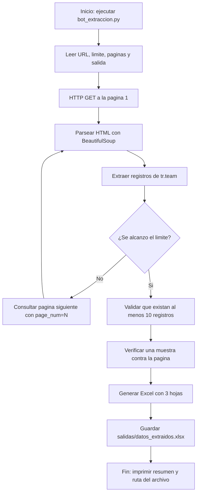

# README3.md - Escáner de Imágenes con IA + Funcionalidades IoT para SIMAP

## 1. Visión General

El proyecto SIMAP (Universal Web Scraper & Intelligence Platform) integra ahora un **módulo de escaneo visual con IA multimodal** utilizando **Google Gemini Vision**. Esta funcionalidad permite al usuario capturar o subir una imagen desde cualquier dispositivo (laptop, PC, tablet o celular) y obtener, en tiempo real, un análisis inteligente con sugerencias de sitios web públicos para monitorear o dar seguimiento a lo identificado.

Esta implementación representa una evolución hacia un enfoque **IoT + Inteligencia Artificial aplicada a monitoreo web**, donde la "percepción" (imagen capturada) se transforma en "acción" (sugerencias accionables + posibilidad de integrar con monitoreo continuo).

---

## 2. Flujo de Funcionamiento: Parte del Navegador (Interacción Usuario)

El flujo visual descrito se implementa completamente en el frontend React + Vite:

### 2.1. Activación del escáner
- El usuario accede a la plataforma y selecciona la pestaña **"Escáner de Imágenes"** en la barra de navegación (`Navbar.jsx`).
- Desde ahí puede elegir entre dos modos: **"Subir imagen"** o **"Usar cámara"**.

### 2.2. Solicitud de permisos de cámara
- Al seleccionar **"Usar cámara"**, el navegador invoca `navigator.mediaDevices.getUserMedia({ video: { facingMode: 'environment' } })`.
- El navegador muestra el diálogo nativo para solicitar permiso de acceso a la cámara (audio/video).
- Una vez aceptado, el stream se asigna al elemento `<video>` en tiempo real.

### 2.3. Vista en tiempo real (Live Preview)
- Componente: `ImageScanner.jsx`
- Se muestra un recuadro con transmisión en vivo desde la cámara del dispositivo.
- Funciona tanto en PC (webcam) como en móviles (cámara frontal/traseira, priorizando `facingMode: 'environment'`).

### 2.4. Captura de la imagen (Disparo)
- Al pulsar el botón **"Tomar foto"**, se dibuja el frame actual desde `<video>` hacia un elemento `<canvas>` invisible.
- Mediante `canvas.toBlob()` se genera una imagen en formato `JPEG` con calidad optimizada (0.9).
- Se crea un `File` con nombre `capture.jpg` y un `ObjectURL` para la vista previa.

### 2.5. Vista previa y apagado automático de cámara
- Tras capturar, la cámara se detiene automáticamente invocando `stopCamera()` que libera todos los `MediaStreamTrack` (`track.stop()`).
- Se muestra la imagen congelada en pantalla para que el usuario confirme qué foto se enviará.
- Desde esta vista puede **"Analizar con Gemini Vision"** o **"Descartar"** (reset) para volver a capturar/subir otra imagen.
- Esto cumple con principios de **privacidad y ahorro de batería**: la cámara solo permanece activa durante la fase de captura.

---

## 3. Flujo de Procesamiento: Servidor + IA (Backend)

### 3.1. Empaquetado de la imagen
- El frontend envía la imagen mediante `FormData` con campo `image` al endpoint:
  - `POST /api/v1/vision/analyze-image`
- Alternativa disponible: `POST /api/v1/vision/analyze-base64` para casos con canvas/data URLs.
- Validaciones: tipo MIME permitido (`image/jpeg,png,webp,heic,heif`), tamaño máximo **20MB**.

### 3.2. Servicio Gemini Vision (`app/services/gemini_vision.py`)
- Clase `GeminiVisionService` configura `google.generativeai` con `GEMINI_API_KEY`.
- Modelo configurable vía `.env`: `GEMINI_VISION_MODEL` (por defecto `gemini-2.5-flash-lite`).
- Generación con `temperature=0.2`, `max_output_tokens=8192` para respuestas concisas y estructuradas.

### 3.3. Prompt estructurado para análisis inteligente
Se envía un prompt detallado a Gemini Vision que instruye explícitamente:

> "Analiza la imagen proporcionada con gran precisión. Identifica qué objeto/elemento aparece, extrae información relevante (texto, marca, modelo, logotipo...), recomienda SÓLO sitios web PÚBLICOS y ÚTILES para monitorear o hacer seguimiento. Prioriza fuentes oficiales, repositorios públicos, bases públicas o fuentes confiables."

El prompt exige **respuesta ÚNICAMENTE en JSON válido** con estructura exacta:

```json
{
  "identificacion": {
    "tipo": "producto|marca|componente|documento|letrero|pantalla|evento|otro",
    "descripcion": "...",
    "texto_visible": [],
    "marca": "...",
    "modelo": "...",
    "elementos_clave": []
  },
  "contexto": "...",
  "sugerencias_monitoreo": [
    {
      "nombre": "...",
      "url": "https://...",
      "categoria": "news|monitoring|tech|finance|general",
      "explicacion": "...",
      "nivel_de_prioridad": "ALTO|MEDIO|BAJO"
    }
  ],
  "palabras_clave": [],
  "recomendaciones_adicionales": "..."
}
```

### 3.4. Procesamiento y respuesta estructurada
- Gemini analiza visualmente la imagen, identifica contexto (componente tecnológico, marca, letrero, documento, pantalla, evento, etc.).
- Genera lista ordenada con **sitios públicos sugeridos**, URLs válidas, categoría, justificación y prioridad.
- El backend retorna este JSON al frontend sin modificaciones, listo para renderizar.

---

## 4. Integración IoT en este Proyecto

Aunque SIMAP es principalmente una plataforma web de inteligencia, la funcionalidad "Escáner con cámara" introduce claramente un **componente IoT/Edge-perception**:

| Aspecto IoT | Implementación en SIMAP | Explicación |
|---|---|---|
| **Dispositivos de borde** | Laptop/PC/Smartphone con cámara | Actúan como sensores visuales (IoT endpoints físicos). |
| **Adquisición de datos** | `getUserMedia` + captura canvas | Adquisición de imagen en tiempo real desde hardware del dispositivo. |
| **Conectividad** | HTTP/REST multipart a backend | Transmisión segura de datos desde nodo IoT (navegador) al servidor central. |
| **Percepción inteligente** | Gemini Vision (ML multimodal) | Traduce datos brutos (pixels) a información semántica accionable. |
| **Privacidad por diseño** | Cámara se apaga tras captura | Minimiza exposición, reduce consumo energético/batería. |
| **Interoperabilidad** | API REST `/api/v1/vision/*` | Integrable con otros sistemas (monitoreo continuo, tracking, reportes). |
| **Acción derivada** | Sugerencias + integración con "Monitoreo Continuo" | Cierra bucle: percepción → análisis → seguimiento automatizado. |

**Visión IoT aplicada:** El escáner convierte cualquier dispositivo con cámara en un **nodo de recolección inteligente**. Una foto puede disparar workflows de vigilancia competitiva, monitoreo de disponibilidad/precios, seguimiento de eventos o verificación de documentos, todo enlazado con el motor de scraping+monitoreo existente.

---

## 5. Arquitectura Técnica Detallada

### 5.1. Backend (FastAPI)
```
Back-Tics/
├── app/
│   ├── api/v1/
│   │   ├── vision.py          # Endpoints POST /vision/analyze-image, /vision/analyze-base64
│   │   ├── endpoint.py         # Scraping + Intelligence (Ollama/Postgres)
│   │   ├── auth.py             # JWT + verificación email
│   │   └── tracking.py         # Monitoreo continuo
│   ├── core/
│   │   ├── config.py           # Config Gemini + DB + JWT + SMTP
│   │   └── database.py
│   ├── services/
│   │   ├── gemini_vision.py    # Servicio Gemini Vision (nuevo)
│   │   ├── ollama_analyzer.py  # IA local existente
│   │   ├── snapshot_service.py # Deltas históricos
│   │   └── monitor_scheduler.py# Scheduler background
│   └── main.py                 # Registro de routers + CORS
├── requirements.txt             # + google-generativeai, pillow
└── .env                        # GEMINI_API_KEY + modelos
```

### 5.2. Frontend (React + Vite + Tailwind)
```
Front-Tics/src/
├── components/vision/
│   └── ImageScanner.jsx        # Componente principal del escáner (nuevo)
├── services/
│   ├── api.js                  # Exporta visionAPI
│   └── ai.js, chat.js
├── components/layout/
│   └── Navbar.jsx              # Añadida pestaña "Escáner de Imágenes"
└── App.jsx                     # Integración de ruta/tab scanner
```

### 5.3. Nuevos Endpoints API
| Método | Ruta | Descripción |
|---|---|---|
| `POST` | `/api/v1/vision/analyze-image` | Recibe `multipart/form-data` con imagen. Retorna análisis JSON con sugerencias. |
| `POST` | `/api/v1/vision/analyze-base64` | Recibe `{ image, mimeType, prompt? }`. Útil para integraciones. |

### 5.4. Variables de Entorno
Añadidas en `Back-Tics/.env`:
```env
# GOOGLE GEMINI (VISION & IA MULTIMODAL)
GEMINI_API_KEY=
GEMINI_VISION_MODEL=gemini-2.5-flash-lite
GEMINI_GENERATION_MODEL=gemini-2.5-flash-lite
GEMINI_MAX_TOKENS=8192
GEMINI_TEMPERATURE=0.2
```

Configuradas también en `app/core/config.py` con defaults seguros.

---

## 6. Funcionalidades Implementadas

| Funcionalidad | Estado | Descripción |
|---|---|---|
| **Captura por cámara web** | ✅ | `getUserMedia` con detección entorno/móvil. |
| **Subida de imagen** | ✅ | File picker con validación MIME/tamaño. |
| **Vista previa antes de enviar** | ✅ | Muestra imagen congelada post-captura. |
| **Apagado automático cámara** | ✅ | `track.stop()` al tomar foto/salir. |
| **Análisis con Gemini Vision** | ✅ | Identificación + extracción texto/marca/modelo. |
| **Sugerencias públicas para monitoreo** | ✅ | Lista con nombre, URL, categoría, explicación, prioridad. |
| **Priorización por nivel** | ✅ | Badges ALTO/MEDIO/BAJO con colores distintivos. |
| **Validación backend** | ✅ | Tipos permitidos + límite 20MB + manejo errores. |
| **UI responsive** | ✅ | Funciona desktop + móvil. |
| **Integración navbar + routing** | ✅ | Nueva pestaña accesible desde App.jsx/Navbar.jsx. |
| **API client (visionAPI)** | ✅ | Servicios frontend listos para consumo. |

---

## 7. Casos de Uso Reales

| Caso | Ejemplo | Resultado esperado |
|---|---|---|
| **Componentes electrónicos** | Foto de placa, chip, conector | Sugiere datasheets oficiales, Octopart, Digi-Key, Mouser, LCSC para monitorear stock/precio. |
| **Marcas/productos** | Logo, empaque, SKU visible | Sugiere sitio oficial marca + comparadores públicos (Keepa, Idealo según contexto). |
| **Letreros/eventos** | Cartel con fecha/lugar | Sugiere medios locales, agenda oficial, páginas de evento para seguimiento. |
| **Documentos/pantallas** | Captura de error, ticket, dashboard | Sugiere KB oficial, issue tracker público, foro soporte según contexto. |
| **Monitoreo competitivo** | Producto en vitrina/web visible | Sugiere sitios de precio público, alertas de stock. |

---

## 8. Seguridad, Privacidad & Buenas Prácticas

- **Permisos mínimos**: Solo solicita `video` (no `audio`) con `getUserMedia`.
- **Liberación de recursos**: `stopCamera()` en `useEffect cleanup`, al capturar y al reset.
- **Validación estricta backend**: whitelist MIME + tamaño máximo.
- **Respuesta estructurada**: Prompt fuerza JSON válido para evitar parsing frágil.
- **Sin almacenamiento de imágenes**: Las imágenes se procesan en memoria y no se guardan en disco por defecto (solo análisis).
- **CORS configurado**: `CORSMiddleware` permite comunicación frontend-backend.
- **Variables sensibles**: `GEMINI_API_KEY` solo en backend `.env` (no expuesta a cliente).

---

## 9. Extensibilidad Futura (Roadmap IoT)

| Idea | Descripción |
|---|---|
| **Persistencia opcional** | Guardar metadatos de análisis (`vision_analyses`) con user_id, timestamp, resultado JSON. |
| **Integración con Monitoreo Continuo** | Botón "Crear target de monitoreo" desde sugerencias → `POST /api/v1/tracking/targets`. |
| **Detección OCR avanzada** | Extraer texto completo con visión + vincular a scraping por keywords. |
| **Barcode/QR scanning** | Detectar códigos EAN/UPC/QR y enriquecer sugerencias. |
| **Streaming/edge** | Integrar con ESP32-CAM + webhook para flujo puramente IoT. |
| **On-device fallback** | Soporte Ollama multimodal si disponible (privacidad 100% local). |
| **Geolocalización opcional** | Si habilitado, enriquecer contexto con ubicación. |

---

## 10. Cómo Probar

### Backend
```bash
cd Back-Tics
pip install -r requirements.txt  # incluye google-generativeai
# Configurar GEMINI_API_KEY en .env
python run_local.py  # o uvicorn app.main:app --reload --port 8000
```

### Frontend
```bash
cd Front-Tics
npm install
npm run dev  # http://localhost:5173
```

### Prueba rápida
1. Ir a `http://localhost:5173` → pestaña **Escáner de Imágenes**
2. Subir imagen o usar cámara
3. Capturar/tomar foto
4. Pulsar **Analizar con Gemini Vision**
5. Revisar identificación + sugerencias de monitoreo con URLs/prioridades

---

**Autor/Proyecto:** SIMAP - Universal Web Scraper & Intelligence Platform  
**Módulo:** Vision + IoT Camera Scanner con Google Gemini Vision  
**Fecha:** Octubre 2026

---

# 11. RPA / Automatización: Bot de Extracción de Datos y Exportación a Excel

> Esta sección documenta la tarea repetitiva identificada, el flujo de automatización diseñado, el bot desarrollado, el archivo Excel generado y la verificación de resultados. Los módulos existentes del proyecto (scraper con Playwright, `ExcelReporter`, endpoints FastAPI, visión con Gemini, monitoreo continuo, etc.) **no fueron modificados**. La automatización se implementó como un componente independiente dentro de `Back-Tics/rpa_bot/`.

## 11.1. Tarea repetitiva identificada

En el contexto de SIMAP, una de las tareas operativas que más se repite es **consultar periódicamente páginas públicas con datos tabulares, extraer los registros y consolidarlos en un archivo Excel para su análisis o reporte**. Cuando esta actividad se realiza manualmente implica abrir el navegador, ubicar la tabla, copiar fila por fila, pegarla en Excel, ordenar columnas, agregar la fuente y revisar errores.

### Capacidades de automatización ya presentes en SIMAP

El análisis del proyecto confirma que SIMAP ya incorpora varios procesos automatizados de alto valor:

| Módulo existente | Automatización que ya resuelve | ¿Se reutilizó para este bot? |
|---|---|---|
| `scraper_service/` | Navegación con Playwright, scroll, extracción de índices y deep scraping a Markdown. | No. El bot usa `requests` + `BeautifulSoup` porque la tabla es HTML estática y no necesita navegador. |
| `app/services/excel_reporter.py` | Reportes Excel ejecutivos con KPIs, gráficos, análisis IA y múltiples hojas. | No. Se mantiene intacto; el bot genera un Excel determinista y simple para datos tabulares. |
| `app/services/monitor_scheduler.py` | Monitoreo periódico en segundo plano con base de datos y alertas por correo. | No. El bot se puede programar con el Programador de tareas o cron, sin depender de PostgreSQL. |
| `app/services/snapshot_service.py` | Comparación histórica de cambios (deltas) entre capturas. | No. El bot agrega fecha de extracción y fuente, suficiente para la demostración de RPA. |
| `app/services/ollama_analyzer.py` | Análisis semántico con IA local. | No. La tarea es determinista y no requiere IA. |
| `app/services/gemini_vision.py` | Escaneo y análisis de imágenes con Gemini Vision. | No. Documentado en las secciones 1 a 10 y sin cambios. |
| `app/api/v1/endpoint.py` | Orquestación REST de scraping, inteligencia y reportes. | No. El bot es un script autónomo que no modifica la API. |

**Conclusión del análisis:** SIMAP ya automatiza el scraping profundo, el monitoreo y los reportes enriquecidos con IA. La oportunidad de automatización identificada es el **flujo repetitivo y determinista de consultar una tabla pública, consolidar registros y entregarlos en Excel con trazabilidad de la fuente**. Para ese caso, una RPA ligera es más eficiente que levantar toda la arquitectura de microservicios, y por eso se implementó como módulo independiente sin alterar lo ya existente.

### Fuente elegida para la demostración

Para la demostración se eligió una fuente pública estable y pensada para prácticas de scraping: **Scrape This Site - Hockey Teams** (`https://www.scrapethissite.com/pages/forms/`), que publica estadísticas de equipos de la NHL por temporada en una tabla HTML paginada.

| Aspecto evaluado | Resultado |
|---|---|
| **Tarea repetitiva** | Consultar la tabla pública de estadísticas NHL, extraer los registros y pasarlos a Excel. |
| **Frecuencia** | Diaria o semanal (reportes de seguimiento). |
| **Volumen** | 25 registros por página; la demostración extrae **40 registros** de 2 páginas. |
| **Tiempo manual estimado** | 20 a 30 minutos para 40 registros, incluyendo copiado, pegado, formato y revisión. |
| **Tiempo automatizado** | Aproximadamente 2 a 5 segundos de ejecución, más la revisión de la muestra. |
| **Tipo de datos** | Estructurados: equipo, año, victorias, derrotas, derrotas OT, % victorias, goles a favor, goles en contra y diferencia. |
| **Reglas del proceso** | Deterministas: misma estructura de tabla, paginación mediante `?page_num=N` y campos identificables por clases CSS. |
| **Riesgo de error manual** | Alto: omisión de filas, columnas desalineadas, valores mal copiados o fuente no registrada. |
| **Beneficio esperado** | Reducción de tiempo, eliminación de errores de transcripción y trazabilidad de la fuente consultada. |
| **Herramienta elegida** | RPA ligera: `requests` + `BeautifulSoup` + `openpyxl`. |
| **Justificación técnica** | La página entrega una tabla HTML estática; no requiere renderizar JavaScript. Usar Playwright/Selenium sería innecesario y más costoso en recursos. El proyecto ya cuenta con Playwright para sitios dinámicos, pero este bot se mantiene independiente y liviano. |

## 11.2. Flujo de automatización diseñado



### Pasos del flujo

1. **Configuración:** el bot recibe URL, límite de registros, máximo de páginas, tamaño de la muestra y ruta de salida mediante argumentos de línea de comandos.
2. **Consulta HTTP:** se realiza una petición `GET` con `requests.Session`, cabeceras de navegador, tiempo de espera y reintentos automáticos para errores 429/5xx.
3. **Extracción:** `BeautifulSoup` localiza las filas `tr.team` y obtiene cada campo por su clase CSS (`name`, `year`, `wins`, `losses`, `ot-losses`, `pct`, `gf`, `ga`, `diff`).
4. **Paginación:** si no se alcanzó el límite, consulta la página siguiente usando `?page_num=N`, con una pausa de 0.5 segundos entre peticiones.
5. **Deduplicación:** descarta duplicados usando la combinación `(equipo, año)`.
6. **Validación:** comprueba que se hayan obtenido al menos 10 registros.
7. **Verificación:** vuelve a consultar las páginas necesarias y compara una muestra de registros campo por campo contra los valores publicados.
8. **Exportación:** genera un libro `.xlsx` con formato, encabezados, autofiltro, panel congelado, hipervínculo a la fuente y hojas de metadatos y verificación.
9. **Registro:** imprime en consola el resumen, la muestra de registros y la ruta final del archivo.

## 11.3. Componentes implementados

```text
Back-Tics/
├── rpa_bot/
│   ├── bot_extraccion.py        # Bot principal: consulta, extrae, verifica y genera Excel
│   ├── verificar_reporte.py     # Verificación independiente del Excel contra la página
│   ├── requirements.txt         # requests, beautifulsoup4 y openpyxl
│   └── salidas/
│       └── datos_extraidos.xlsx # Archivo Excel generado con 40 registros
├── README3.md                   # Esta documentación
└── ...                          # Módulos existentes sin modificaciones
```

### Archivos nuevos

| Archivo | Función |
|---|---|
| `rpa_bot/bot_extraccion.py` | Bot principal. Consulta la página, recorre la paginación, extrae los registros, verifica la muestra y escribe el Excel. |
| `rpa_bot/verificar_reporte.py` | Script de verificación independiente: lee el Excel generado y compara una muestra contra la página en vivo. |
| `rpa_bot/requirements.txt` | Dependencias mínimas del bot. |
| `rpa_bot/salidas/datos_extraidos.xlsx` | Evidencia generada: datos extraídos, fuente de consulta y verificación de muestra. |

### Componentes existentes que **no** se modificaron

| Componente existente | Motivo de no modificación |
|---|---|
| `scraper_service/scraper.py` y `deep_scraper.py` | Ya implementan scraping con Playwright para sitios dinámicos y pipelines profundos. |
| `app/services/excel_reporter.py` | Ya genera reportes Excel ejecutivos con múltiples hojas, gráficos y análisis IA. El bot RPA usa un formato propio, más simple y determinista, sin alterar el reporter existente. |
| `app/api/v1/endpoint.py` | Los endpoints de scraping, inteligencia y reportes siguen intactos. |
| `app/services/monitor_scheduler.py` | El monitoreo continuo con base de datos y alertas no se modifica. |
| `app/services/gemini_vision.py` y módulo Vision | La funcionalidad de escaneo con IA documentada en las secciones 1 a 10 permanece sin cambios. |
| `docker-compose.yml`, PostgreSQL, Ollama | El bot no requiere la infraestructura completa; funciona de forma autónoma con Python y conexión a Internet. |

## 11.4. Requisitos e instalación

- Python 3.10 o superior.
- Conexión a Internet para consultar la página pública.
- Dependencias:

```bash
cd Back-Tics
pip install -r rpa_bot/requirements.txt
```

Contenido de `rpa_bot/requirements.txt`:

```text
requests>=2.31.0
beautifulsoup4>=4.12.0
openpyxl>=3.1.2
```

## 11.5. Ejecución

### Ejecución por defecto

```bash
cd Back-Tics
python rpa_bot/bot_extraccion.py
```

Por defecto consulta `https://www.scrapethissite.com/pages/forms/`, extrae **40 registros** de hasta 2 páginas, verifica 5 registros y guarda el resultado en `rpa_bot/salidas/datos_extraidos.xlsx`.

### Ejecución con parámetros

```bash
python rpa_bot/bot_extraccion.py \
  --url "https://www.scrapethissite.com/pages/forms/" \
  --limite 40 \
  --paginas 2 \
  --muestra 5 \
  --salida "rpa_bot/salidas/datos_extraidos.xlsx"
```

| Argumento | Valor por defecto | Descripción |
|---|---|---|
| `--url` | `https://www.scrapethissite.com/pages/forms/` | Página pública a consultar. |
| `--limite` | `40` | Número de registros a extraer. Debe ser **mayor o igual a 10**. |
| `--paginas` | `2` | Máximo de páginas a recorrer. |
| `--muestra` | `5` | Cantidad de registros que se compararán contra la página. |
| `--salida` | `rpa_bot/salidas/datos_extraidos.xlsx` | Ruta del archivo Excel generado. |
| `--sin-verificacion` | Desactivado | Omite la comparación de la muestra. |

### Verificación independiente

```bash
cd Back-Tics
python rpa_bot/verificar_reporte.py
```

También se puede indicar otro archivo o tamaño de muestra:

```bash
python rpa_bot/verificar_reporte.py --archivo "rpa_bot/salidas/datos_extraidos.xlsx" --muestra 10
```

El script lee los registros del Excel, vuelve a consultar las páginas necesarias y compara los campos `Equipo`, `Año`, `Victorias`, `Derrotas`, `% Victorias`, `Goles a favor`, `Goles en contra` y `Diferencia`. Devuelve código de salida `0` si todas las comparaciones coinciden y `1` si encuentra diferencias.

## 11.6. Estructura del archivo Excel

El libro `datos_extraidos.xlsx` contiene tres hojas:

### Hoja 1: `Datos Extraídos`

Tabla principal con encabezados claros y una fila por registro:

| N° | Equipo | Año | Victorias | Derrotas | Derrotas OT | % Victorias | Goles a favor | Goles en contra | Diferencia | Página fuente | Fuente (URL) | Fecha de extracción |
|---|---|---|---|---|---|---|---|---|---|---|---|---|
| 1 | Boston Bruins | 1990 | 44 | 24 |  | 0.55 | 299 | 264 | 35 | 1 | https://www.scrapethissite.com/pages/forms/ | 2026-11-05 00:08:18 |
| 2 | Buffalo Sabres | 1990 | 31 | 30 |  | 0.388 | 292 | 278 | 14 | 1 | https://www.scrapethissite.com/pages/forms/ | 2026-11-05 00:08:18 |
| 3 | Calgary Flames | 1990 | 46 | 26 |  | 0.575 | 344 | 263 | 81 | 1 | https://www.scrapethissite.com/pages/forms/ | 2026-11-05 00:08:18 |

Características de la hoja:

- Encabezados en la fila 1 con fondo azul corporativo, texto blanco y bordes.
- Panel congelado en `A2` para mantener los encabezados visibles.
- Autofiltro habilitado sobre toda la tabla.
- Columnas numéricas alineadas al centro y textos a la izquierda.
- Filas alternadas en color para facilitar la lectura.
- La columna **Fuente (URL)** contiene un hipervínculo a la página consultada.
- La columna **Fecha de extracción** registra el momento exacto de la consulta.

### Hoja 2: `Fuente y Metadatos`

Registra la trazabilidad del proceso:

| Campo | Ejemplo |
|---|---|
| Reporte | Estadísticas NHL por temporada (registros y años) |
| Sitio consultado | Hockey Teams: Forms, Searching and Pagination - Scrape This Site |
| Fuente de consulta | https://www.scrapethissite.com/pages/forms/ |
| Páginas consultadas | Página 1 y `?page_num=2` |
| Total de registros | 40 |
| Fecha de ejecución | Fecha y hora de la corrida |
| Método de extracción | RPA básica: HTTP GET + BeautifulSoup + paginación |
| Bot | `Back-Tics/rpa_bot/bot_extraccion.py` v1.0.0 |
| Verificación de muestra | 5 registros, 40 campos, 40 coincidencias, 0 diferencias |
| Nota | Sitio público de práctica; consultas con pausas y sin autenticación |

### Hoja 3: `Verificación de Muestra`

Contiene la comparación campo por campo:

| Equipo | Año | Campo | Valor en Excel | Valor en la página | Resultado |
|---|---|---|---|---|---|
| Boston Bruins | 1990 | Equipo | Boston Bruins | Boston Bruins | Coincide |
| Boston Bruins | 1990 | Año | 1990 | 1990 | Coincide |
| Boston Bruins | 1990 | Victorias | 44 | 44 | Coincide |
| Boston Bruins | 1990 | % Victorias | 0.55 | 0.55 | Coincide |
| New Jersey Devils | 1990 | Diferencia | 8 | 8 | Coincide |

Las filas correctas se resaltan en verde y las diferencias en rojo.

## 11.7. Resultados de la ejecución real

La ejecución de demostración se realizó con los valores por defecto:

```text
Fuente: https://www.scrapethissite.com/pages/forms/
Límite de registros: 40 | Páginas máximas: 2
Registros extraídos: 40
Páginas consultadas: 2
Verificación: 5 registros | 40 campos | 40 coincidencias | 0 diferencias
Archivo Excel generado: Back-Tics/rpa_bot/salidas/datos_extraidos.xlsx
Hojas: Datos Extraídos | Fuente y Metadatos | Verificación de Muestra
```

Muestra de los primeros 10 registros obtenidos:

| N° | Equipo | Año | V | D | % | GF | GC | Dif |
|---|---|---|---|---|---|---|---|---|
| 1 | Boston Bruins | 1990 | 44 | 24 | 0.55 | 299 | 264 | 35 |
| 2 | Buffalo Sabres | 1990 | 31 | 30 | 0.388 | 292 | 278 | 14 |
| 3 | Calgary Flames | 1990 | 46 | 26 | 0.575 | 344 | 263 | 81 |
| 4 | Chicago Blackhawks | 1990 | 49 | 23 | 0.613 | 284 | 211 | 73 |
| 5 | Detroit Red Wings | 1990 | 34 | 38 | 0.425 | 273 | 298 | -25 |
| 6 | Edmonton Oilers | 1990 | 37 | 37 | 0.463 | 272 | 272 | 0 |
| 7 | Hartford Whalers | 1990 | 31 | 38 | 0.388 | 238 | 276 | -38 |
| 8 | Los Angeles Kings | 1990 | 46 | 24 | 0.575 | 340 | 254 | 86 |
| 9 | Minnesota North Stars | 1990 | 27 | 39 | 0.338 | 256 | 266 | -10 |
| 10 | Montreal Canadiens | 1990 | 39 | 30 | 0.487 | 273 | 249 | 24 |

Resultado de la verificación independiente:

```text
Muestra verificada: 5 registros | 40 campos | 40 coincidencias | 0 diferencias
[RESULTADO] La muestra coincide con los datos publicados en la página.
```

La muestra incluyó registros de ambas páginas (por ejemplo, `Boston Bruins 1990` de la página 1 y `Minnesota North Stars 1991`, `Toronto Maple Leafs 1991` de la página 2), confirmando que la paginación y la extracción funcionan correctamente.

## 11.8. Programación periódica del bot

El bot puede ejecutarse de forma desatendida mediante el programador del sistema operativo.

### Windows (Programador de tareas)

```powershell
schtasks /Create /TN "SIMAP RPA Hockey" /TR "python D:\Escritorio\SIMAP\SIMAP\Back-Tics\rpa_bot\bot_extraccion.py" /SC DAILY /ST 07:00
```

Para usar un entorno virtual, indicar la ruta completa del ejecutable de Python del entorno.

### Linux/macOS (cron)

```bash
0 7 * * * cd /ruta/Back-Tics && /ruta/venv/bin/python rpa_bot/bot_extraccion.py
```

### Buenas prácticas de operación

- Ejecutar en horarios de baja carga para no afectar al sitio consultado.
- Mantener la pausa entre páginas y no aumentar la concurrencia sin necesidad.
- Versionar el archivo Excel generado o moverlo a un histórico con fecha.
- Revisar la hoja de verificación después de cada ejecución.
- Si la estructura del sitio cambia, actualizar los selectores en `extraer_pagina`.

## 11.9. Seguridad, ética y límites

- **Solo datos públicos:** el bot consulta información publicada sin autenticación ni datos personales.
- **Sin credenciales:** no utiliza usuarios, contraseñas ni tokens.
- **Respeto al sitio:** usa un `User-Agent` identificable, pausas entre peticiones y reintentos con retroceso exponencial.
- **Fuente documentada:** cada fila incluye la URL de origen y la fecha de extracción.
- **Sin sobrecarga:** el volumen es bajo (2 páginas y 40 registros en la demostración).
- **Sitio de práctica:** Scrape This Site es un sandbox público creado para aprender scraping; aun así se aplican límites de cortesía.
- **Mantenimiento:** si el sitio modifica sus clases CSS o la paginación, el bot debe actualizarse. Los selectores actuales son `tr.team` y las clases `name`, `year`, `wins`, `losses`, `ot-losses`, `pct`, `gf`, `ga`, `diff`.

## 11.10. Solución de problemas

| Problema | Causa probable | Solución |
|---|---|---|
| `No se pudo consultar la página` | Sin Internet, URL incorrecta o bloqueo temporal. | Verificar la URL, la conexión y reintentar. |
| Menos de 10 registros | Límite bajo, página sin filas o cambio de estructura. | Aumentar `--limite`/`--paginas` o revisar los selectores. |
| Diferencias en la verificación | El sitio cambió entre la extracción y la verificación, o cambió el HTML. | Volver a ejecutar el bot y revisar los selectores. |
| Archivo Excel no encontrado en la verificación | Aún no se ejecutó el bot o la ruta es distinta. | Ejecutar `bot_extraccion.py` o usar `--archivo` con la ruta correcta. |
| Acentos o caracteres extraños en consola | Codificación de la terminal de Windows. | El archivo Excel conserva los caracteres correctos; ajustar la codepage si se desea. |

## 11.11. Evidencias entregables

| Evidencia | Ubicación |
|---|---|
| Código del bot | `Back-Tics/rpa_bot/bot_extraccion.py` |
| Verificación independiente | `Back-Tics/rpa_bot/verificar_reporte.py` |
| Dependencias | `Back-Tics/rpa_bot/requirements.txt` |
| Archivo Excel con 40 registros, encabezados, fuente y verificación | `Back-Tics/rpa_bot/salidas/datos_extraidos.xlsx` |
| Documentación del flujo y resultados | `Back-Tics/README3.md` (esta sección) |

---

**Módulo:** RPA / Automatización - Extracción de datos públicos y exportación a Excel  
**Estado:** Implementado y verificado (40 registros, 2 páginas, 40/40 campos coincidentes)  
**Fecha:** Noviembre 2026